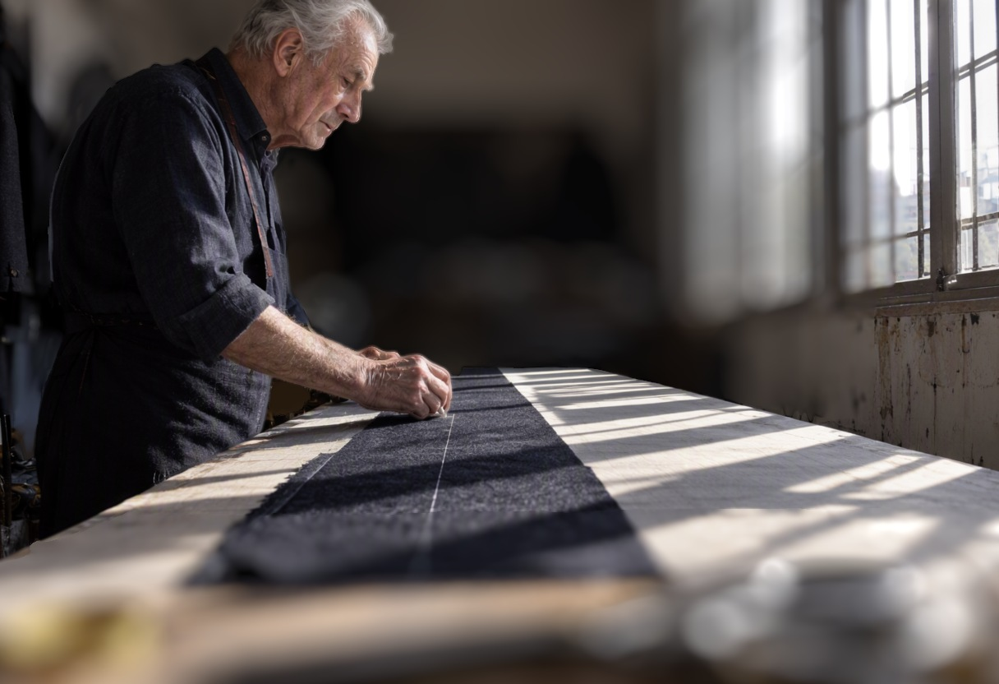

# Emulate a real camera in MOSS-Image

A ComfyUI workflow that adds lens framing, focus, background blur, exposure and a vignette after the render, from menus, so your person and scene stay the same. Click what you want in focus and pick a look.

More examples are in the blog post: [robertcreative.com/blog/moss-image-camera-settings](https://robertcreative.com/blog/moss-image-camera-settings)

## Install

1. Install or update [ComfyUI](https://www.comfy.org/download). I tested on version 0.44.
2. Copy the `depth_lens_fx` folder into `ComfyUI/custom_nodes/`, and restart ComfyUI.
3. Drag `workflows/moss-camera-settings.json` onto the canvas.
4. Download any MOSS-Image files ComfyUI says are missing:

| File | Folder inside `ComfyUI/models/` |
|---|---|
| [moss_image_sft_int8_convrot.safetensors](https://huggingface.co/Comfy-Org/MOSS-Image/resolve/main/diffusion_models/moss_image_sft_int8_convrot.safetensors) (5.4 GB) | `diffusion_models` |
| [qwen3.5_9b_w4a8_gptq.safetensors](https://huggingface.co/Comfy-Org/MOSS-Image/resolve/main/text_encoders/qwen3.5_9b_w4a8_gptq.safetensors) (7.3 GB) | `text_encoders` |
| [flux2-vae.safetensors](https://huggingface.co/Comfy-Org/MOSS-Image/resolve/main/vae/flux2-vae.safetensors) (336 MB) | `vae` |

The first run also downloads two small models, about 280 MB in total, and both run on the CPU: [Depth Anything V2 Small](https://huggingface.co/depth-anything/Depth-Anything-V2-Small-hf) (Apache-2.0) for distance, and [BiRefNet Lite](https://huggingface.co/ZhengPeng7/BiRefNet_lite) (MIT) for the subject's edge. The edge model adds about 7 seconds per new image on a CPU.

## Use it

1. Write your prompt and press **Run**. It stops after the first render, with your image in the **Camera Settings** node.
2. **Click what you want in focus.** The box shows what the lens will keep.
3. Pick your menus and press **Run** again. Only the finish runs, because the render is reused.

For a new picture, change the seed or the prompt and click again. Keep the seed on **fixed**: on randomize, every Run makes a new image, so it stops every time.

## The menus

| Menu | Choices | Good to know |
|---|---|---|
| `lens` | 35mm (whole shot), 50mm, 85mm | This is a crop. It doesn't change perspective, can't go wider, and small faces go soft at long lengths. For anything longer, use the separate Lens Crop node. |
| `aperture` | Sharp, Soft, Blurred, Very blurred | It needs distance. A wall right behind the subject stays nearly sharp. |
| `background_light` | Normal, Dim, Dark | Best with a deep room behind the subject. It can paint hard dark shapes on a flat wall, and eases off when most of the background is near white. |
| `exposure` | -2 to +2 stops | It can't bring back detail the image doesn't have. |
| `vignette` | Off, Light, Medium, Heavy | Darkens the corners. |
| `face_detail` | Off, Safe, Strong | Off by default. It redraws the crop and invents detail. Only try it when the face is large in the frame: it damages small faces, mouths and eyes first. |
| `keep_sharp` | Narrow, Normal, Wide | Use Wide if part of the subject goes soft. |
| `subject_edge` | Crisp, Natural, Soft, Very soft | Soften it if the subject looks cut out. Very soft can blur a face in profile. |
| `foreground` | Sharp, Blurred | Whether things nearer than your click go soft too. To focus on something close, just click it. |

A good place to start: 50mm, aperture Soft or Blurred, Normal light, Light vignette, face detail off. For a portrait, go to 85mm.

## Limits

- The clean edge only applies when you click the main subject. Click something else, like an object in the foreground, and the edge comes from the depth map, which is rougher.
- Tabletop products can get a hard line where sharp meets blurred.
- Thin things like nets confuse the depth map.
- With `foreground` on Blurred, open ground can show a sharp strip with blurred bands in front and behind.
- Text in renders often comes out garbled.
- The blur nodes work on any image, but this workflow's render and detail steps are for MOSS-Image only.

## Other nodes

`Depth Lens Blur`, `Lens Crop`, `Exposure`, `Radial Vignette` and `Motion Blur` have number inputs, if you'd rather wire them yourself. They're under `image/lens`.

## License

MIT. By Robert Gourley.
